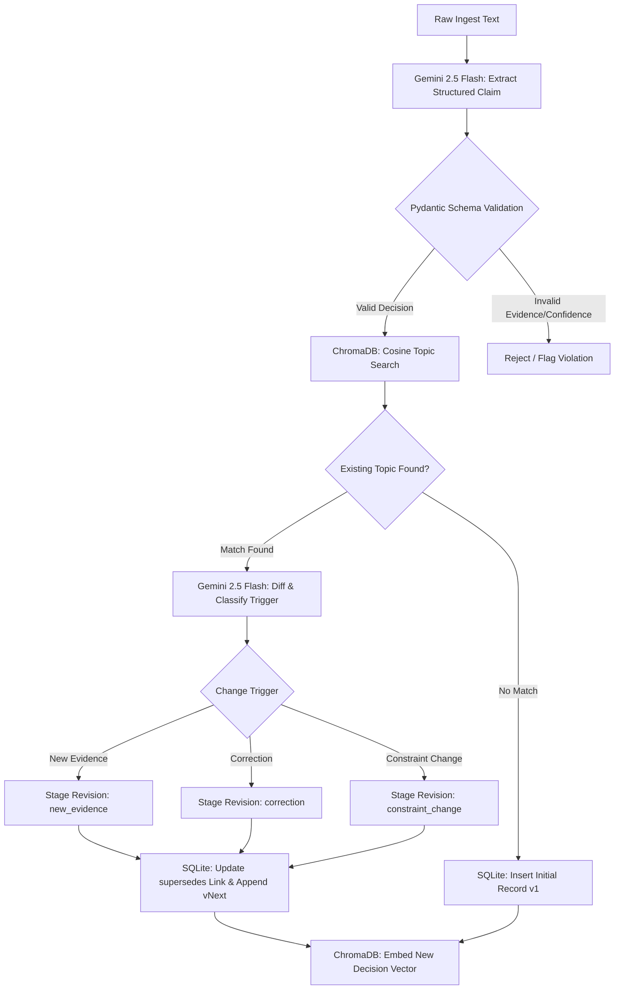

# Decision Provenance Agent

**Not just "what happened" — "why we changed our minds," as a first-class, queryable object.**

[](https://python.org)
[](https://fastapi.tiangolo.com)
[](https://github.com/langchain-ai/langgraph)
[](https://www.trychroma.com/)
[](https://ai.google.dev)
[](./tests)

---

## 🎯 The Problem

Every traditional RAG system, vector database, and agent memory layer answers one question well:

> *"What is the current state of X?"*

But in multi-agent and enterprise environments, they all fail at:

> *"Why did we move from decision A to decision B?"*  
> *"What did we used to think, and what exact evidence triggered the change?"*

When memory layers only store flat facts or naive embeddings, **the causal reasoning that connected two states is permanently lost**. New facts either silently overwrite previous conclusions or sit beside contradictory records, leading to agent loops and hallucinations.

---

## 💡 The Solution: Decision Records with Lineage

This agent treats every stored knowledge item as an **immutable, append-only decision record with explicit provenance**:

```
Record v1: "Use Postgres for user service" (reason: team familiarity)
    ↓ superseded by (trigger: new evidence | confidence: 0.92)
Record v2: "Use Postgres with read replicas" (reason: load tests showed bottleneck)
    ↓ superseded by (trigger: constraint change | confidence: 0.95)
Record v3: "Migrate to CockroachDB" (reason: multi-region compliance mandate)
```

### Two Deterministic Query Modes:
1. `GET /query/{topic}?mode=current` → **Latest Active Decision** (Record v3).
2. `GET /query/{topic}?mode=provenance` → **Full Audit Chain** with triggers, timestamps, and confidence scores.

---

## 🏗️ State Pipeline Architecture



---

## 🧪 Comprehensive Evaluation & Test Coverage (22/22 Green)

This repository includes a rigorous test harness covering schema validation, SQLite storage integrity, and end-to-end pipeline execution:

```bash
# Run the complete test suite
pytest -v
```

### Test Suite Highlights:
- **`tests/test_models.py` (9 tests):** Schema-level trust verification (rejection of ungrounded claims, confidence score bounding `[0.0, 1.0]`, enum validation for change triggers).
- **`tests/test_storage.py` (9 tests):** Immutable SQLite append-only storage, correct chain order traversal, topic isolation, and JSON evidence formatting.
- **`tests/test_pipeline.py` (4 tests):** Full LangGraph multi-step pipeline integration from raw text to superseded revision chaining.

```
============================= test session starts =============================
collected 22 items

tests/test_models.py::TestDecisionRecordValidation::test_valid_new_record PASSED
tests/test_models.py::TestDecisionRecordValidation::test_valid_revision_record PASSED
tests/test_models.py::TestDecisionRecordValidation::test_reject_supersedes_without_change_trigger PASSED
tests/test_models.py::TestDecisionRecordValidation::test_reject_empty_evidence PASSED
tests/test_models.py::TestDecisionRecordValidation::test_reject_confidence_out_of_range PASSED
tests/test_pipeline.py::TestPipelineIntegration::test_store_new_record_and_query_current PASSED
tests/test_pipeline.py::TestPipelineIntegration::test_store_revision_and_query_provenance PASSED
tests/test_pipeline.py::TestFullPipeline::test_full_ingest_flow PASSED
tests/test_storage.py::TestSQLiteStorage::test_get_provenance_chain_order PASSED
...
======================= 22 passed, 1 warning in 22.31s ========================
```

---

## 🚀 Quickstart: Run in 3 Steps

### 1. Installation
```bash
git clone https://github.com/Akshu24Tech/decision_provenance_agent.git
cd decision_provenance_agent
pip install -r requirements.txt
```

### 2. Configuration
Create `.env` with your Gemini API key:
```env
GOOGLE_API_KEY=your_gemini_api_key
CHROMA_PERSIST_DIR=./chroma_data
SQLITE_DB_PATH=./decisions.db
```

### 3. Launch the Server
```bash
uvicorn app.main:app --reload --port 8000
```
API Documentation will be live at `http://localhost:8000/docs`.

---

## 💻 Quick API Example

### 1. Ingest an Initial Decision
```bash
curl -X POST http://localhost:8000/ingest \
  -H "Content-Type: application/json" \
  -d '{"text": "We decided to use Postgres for the user service. The team is already familiar with it."}'
```

### 2. Ingest an Updated Decision (New Evidence)
```bash
curl -X POST http://localhost:8000/ingest \
  -H "Content-Type: application/json" \
  -d '{"text": "After running load tests, we are switching to Postgres with read replicas. Single instance cannot handle projected traffic."}'
```

### 3. Query Active State vs. Historical Lineage
```bash
# Query active state
curl http://localhost:8000/query/database_choice?mode=current

# Query why the decision changed (lineage)
curl http://localhost:8000/query/database_choice?mode=provenance
```

---

## 📁 Repository Structure

```
decision_provenance_agent/
├── app/
│   ├── main.py              # FastAPI endpoints (/ingest, /query, /topics)
│   ├── models.py            # Pydantic schemas (DecisionRecord, ChangeTrigger)
│   ├── pipeline.py          # LangGraph state machine & reasoning nodes
│   └── storage.py           # Dual storage: SQLite (lineage chain) + ChromaDB (vectors)
├── demo/
│   └── demo_seed.py         # Interactive command-line simulation script
├── tests/
│   ├── test_models.py       # Trust rule enforcement unit tests
│   ├── test_storage.py      # SQLite chain ordering & query tests
│   └── test_pipeline.py     # End-to-end integration tests
├── ARCHITECTURE.md          # In-depth architectural whitepaper
├── requirements.txt         # Minimal production dependencies
└── README.md
```

---

## 🛡️ Trust Architecture & Design Principles

| Pillar | Implementation | Why It Matters |
|---|---|---|
| **Evidence Requirement** | Pydantic validator rejects claims without evidence | Eliminates unsubstantiated agent claims before storage. |
| **Mandatory Triggers** | Revisions must categorize `new evidence`, `correction`, or `constraint change` | Eliminates silent fact overwrites. |
| **Immutable Append-Only** | SQLite retains superseded records permanently | Full enterprise auditability and compliance. |
| **Separation of Concerns** | Vectors for semantic lookup, relational graph for causal order | Vector similarity does not represent causal truth. |

---

## 👨‍💻 Author

**Akshu Grewal**  
*Agentic AI Engineer specializing in verifiable, reliable tool-using systems.*  
- GitHub: [@Akshu24Tech](https://github.com/Akshu24Tech)  
- Focus: LangGraph · Google ADK · Evals & Grounding · Fast APIs
